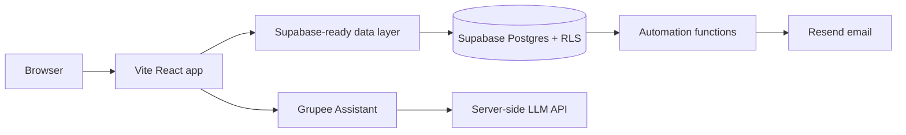

# Grupee

LIVE URL: `PLACEHOLDER — deploy from Vercel`

GITHUB REPO: https://github.com/brightmay05/grupee.git

Grupee is a property-pooling platform where people discover vetted property opportunities, contribute toward a pool, and track their ownership share.

## Problem solved

Buying property alone is out of reach for many people. Informal property groups often rely on WhatsApp and spreadsheets, which creates weak record-keeping and little transparency. Grupee structures that process with pool funding progress, share calculations, protected accounts and clear activity.

## Demo credentials

- Investor: `reviewer@grupee.demo` / `GrupeeDemo!2026`
- Admin: `admin@grupee.demo` / `GrupeeDemo!2026`

The current build uses realistic demo data and clearly labels payments as simulated. Connect Supabase before accepting real users or money.

## Run locally

```powershell
npm.cmd install
npm.cmd run dev
npm.cmd run build
npm.cmd run lint
```

## Architecture



## Supabase migration

Run `supabase/migrations/001_initial_schema.sql` in the Supabase SQL editor. It contains profiles, properties, pools, memberships, transactions, enquiries, notifications, AI logs, automation logs, indexes, triggers and basic RLS policies. Configure auth email confirmations and environment variables before production use.

For a complete first-time setup, including demo login accounts, run [supabase/complete_setup.sql](supabase/complete_setup.sql) once in Supabase SQL Editor instead of using the original migration alone.

### Supabase login setup

1. Open Supabase, then open SQL Editor and run the contents of `supabase/complete_setup.sql`.
2. In Authentication > Providers, enable Email and disable confirmation requirements only while testing.
3. In Authentication > URL Configuration, add `https://grupee.vercel.app` and your Vercel preview domains.
4. Set `VITE_SUPABASE_URL` and `VITE_SUPABASE_ANON_KEY` in Vercel, then redeploy.
5. Test:
   - Investor: `investor@grupee.demo` / `GrupeeDemo!2026`
   - Admin: `admin@grupee.demo` / `GrupeeDemo!2026`

The setup script creates a profile automatically whenever a Supabase Auth user is created, seeds demo accounts, and enables row-level security policies. Change demo passwords before public launch.

## Required environment variables

```text
VITE_SUPABASE_URL=
VITE_SUPABASE_ANON_KEY=
SUPABASE_SERVICE_ROLE_KEY=
GEMINI_API_KEY=
OPENAI_API_KEY=
RESEND_API_KEY=
RESEND_FROM_EMAIL=
VITE_GOOGLE_MAPS_API_KEY=
VITE_APP_URL=http://localhost:5173
```

## Deployment to Vercel

1. Push this repository to GitHub.
2. Import the repository at `https://vercel.com/new`.
3. Framework preset: Vite.
4. Build command: `npm run build`.
5. Output directory: `dist`.
6. Add the environment variables above. Set `GEMINI_API_KEY` as a server-only variable; never prefix it with `VITE_`.
7. Configure the Supabase redirect URLs for the Vercel domain.
8. Add the custom domain if required.

## Test checklist

- Home, browse, pool detail and join flow
- Login and signup screens
- Investor and admin dashboards
- Light/dark theme and mobile navigation
- Share calculations remain non-negative and capped by available pool capacity
- AI assistant shows the financial-advice disclaimer
- SQL migration and RLS policies reviewed before real data

See `docs/PROJECT_EXPLANATION.md` for the implementation and architecture notes.
